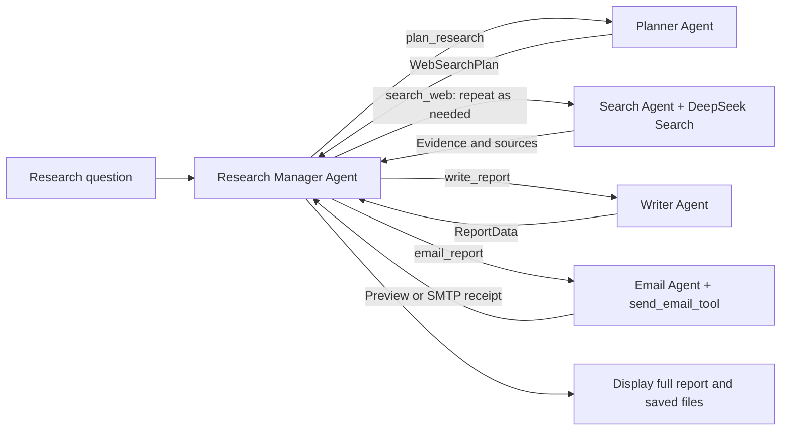

# Deep Research — Orchestration via Tools

**English** | [简体中文](README.zh-CN.md)

A standalone adaptation of the OpenAI Agents SDK Lab 4 assignment, based on
[Deep Research from ed-donner/agents](https://github.com/ed-donner/agents/tree/62569708496917d5e2d5ce1652902d7c80f6b896/2_openai/deep_research).
It applies the orchestration pattern from Lab 2, **Part 3 → 3a: via Tools**, to the research workflow.

## Assignment and approach

The assignment points to `agents/2_openai/deep_research/` and asks for
**Orchestration via Tools**. This implementation preserves the research tasks
while putting a Manager Agent in charge of orchestration.

In the original implementation, `ResearchManager` is an ordinary Python class
that runs four agents in a predefined sequence. This version introduces
`Agent(name="Research Manager", tools=[...])`, wrapping the Planner, Search,
Writer and Email agents with four `.as_tool()` calls. Each specialist returns
its result to the Manager.

This follows the [Agents as tools pattern](https://developers.openai.com/api/docs/guides/agents/orchestration).
It does not use handoffs or wrap the entire original pipeline in a single tool.
The assignment screenshot does not specify a submission format, detailed rubric
or additional experiments; this project does not assume those requirements.

## Quick start — Windows PowerShell

Python 3.12 is recommended. Run these commands from the project root:

```powershell
python -m venv .venv
.\.venv\Scripts\python.exe -m pip install -r requirements.txt
if (!(Test-Path .env)) { Copy-Item .env.example .env }
```

The default provider is the **official DeepSeek API**. Configure at least these
values in the project-root `.env` file:

```dotenv
MODEL_PROVIDER=deepseek
DEEPSEEK_API_KEY=your-deepseek-api-key
DEFAULT_MODEL_NAME=deepseek-flash
HOW_MANY_SEARCHES=5
ENABLE_TRACING=false
```

The configured default model is `deepseek-flash`, based on the DeepSeek documentation
reviewed on October 25, 2026. The SDK uses DeepSeek's Responses API for model calls,
including structured output and tool calling. The Search Agent uses a function tool
to call the DeepSeek Search API with the same `DEEPSEEK_API_KEY`.

DeepSeek mode does not require an OpenAI key or upload traces to OpenAI.
Model access, search access and account balance must be checked with the provider.
Live runs make billable model and search requests under the provider's pricing.

To use the OpenAI option, set `MODEL_PROVIDER=openai`,
`DEFAULT_MODEL_NAME=gpt-5.4-mini` and `OPENAI_API_KEY`. Search then uses the hosted
`WebSearchTool`. API endpoints are explicitly selected by provider.

Start the interface:

```powershell
.\.venv\Scripts\python.exe -m deep_research.app
```

Open the local URL printed in the terminal, usually `http://127.0.0.1:7860`.
Enter a research question and click **Start research**. Email delivery is off by
default. All four agents still participate, and the Email Agent creates an `.eml` preview.

You can also run research from the command line:

```powershell
.\.venv\Scripts\python.exe -m deep_research "Compare retrieval-augmented generation and fine-tuning for a university FAQ assistant."
```

## Email configuration

The reviewed upstream project uses SMTP (`messenger.py`). This adaptation also
uses SMTP, supporting implicit SSL/TLS and STARTTLS. By default, it creates a
local preview only: **a preview does not mean an email was sent**.

For delivery, configure the sender in `.env`:

```dotenv
EMAIL_SMTP_SERVER=smtp.qq.com
EMAIL_SMTP_PORT=465
EMAIL_ADDRESS=your-qq-address@qq.com
EMAIL_APP_PASSWORD=your-qq-mail-authorization-code
```

In the separate **Email settings** section, enable **Send report by email** and
enter a **Recipient email**. A recipient is required when delivery is enabled.
When delivery is off, the application creates a report and preview only.
The recipient and delivery choice belong to each run; the application does not
read the legacy `.env` variable `EMAIL_TO`.

The interface, report, summary, follow-up questions and email content are in
English. Research questions may still be entered in Chinese.

For command-line delivery, supply the recipient explicitly:

```powershell
.\.venv\Scripts\python.exe -m deep_research "Your research question" --send-email --recipient name@example.com
```

Port 465 uses implicit SSL/TLS; other ports require STARTTLS, typically on port 587.
Both paths verify TLS certificates. To check the SMTP connection and login without
sending an email, run:

```powershell
.\.venv\Scripts\python.exe -m deep_research.check_email
```

Restart Gradio after changing `.env`. OAuth email authentication is not implemented.
See the [email setup guide (Chinese)](docs/EMAIL_SETUP.md) for QQ authorization codes
and notes on Gmail and MUST student accounts. Receiving email through a school
account does not establish that password-based SMTP sending is enabled; the
school tenant's support for this has not been verified.

The status `accepted_by_smtp` means the SMTP server accepted the message, not that
inbox delivery has been confirmed. The application prevents repeated send attempts
within a run. After a timeout, check the inbox before deciding to run again.
Keep `.env`, authorization codes and API keys private; `.env` is excluded by `.gitignore`.

## Implementation

| File | Responsibility |
| --- | --- |
| `deep_research/manager_agent.py` | Manager instructions, four `.as_tool()` definitions and structured result extraction |
| `deep_research/research_manager.py` | One top-level `Runner.run_streamed(manager_agent, ...)`, progress events, persistence and completion checks |
| `deep_research/planner_agent.py` | Produces `WebSearchPlan`; plans five searches by default |
| `deep_research/search_agent.py` | Selects a search tool by provider and returns evidence summaries with source links |
| `deep_research/deepseek_search.py` | Calls the DeepSeek Search API and preserves URLs, dates and evidence text |
| `deep_research/providers.py` | Configures the SDK for the official DeepSeek or OpenAI Responses API |
| `deep_research/writer_agent.py` | Produces `ReportData`: summary, full Markdown report and follow-up questions |
| `deep_research/email_agent.py` | Email Agent and function tool for previews or SMTP delivery |
| `deep_research/app.py` | Gradio interface and Manager tool-call log |
| `tests/` | Offline SDK orchestration, error handling, email and configuration tests |



The Manager's instructions describe task dependencies; the model generates the
actual tool calls. It is instructed to call one tool at a time and use the result
to decide the next step, with up to two additional searches. Because DeepSeek's
documented behavior ignores `parallel_tool_calls`, SDK tool execution concurrency
is also limited to one. This limits simultaneous execution; it does not guarantee
that the model emits only one tool call per response.

Top-level and specialist `max_turns` limits bound execution loops, not cost.
The extra-search allowance is primarily a prompt constraint; turn limits provide
the hard stopping boundary. Live model decisions and research quality still need review.

Result extractors only serialize or save results; they do not invoke the next stage.
If Planner or Writer output fails format validation, the tool returns a retry
request to the Manager, which can call the same tool again. Each stage allows one
format retry. Other errors and email delivery do not use this retry path.

The Writer reads the original question and all search summaries from the current
run's state, so the Manager does not need to copy long evidence into tool arguments.
The `ResearchManager` class remains as the application wrapper; the agent in
`manager_agent.py` performs orchestration.

## Outputs and inspection

Each run saves its files under `outputs/<UTC_timestamp_random_ID>/`:

- `report.md`: the Writer's full original report, preserved independently of the Manager's final reply.
- `report.json`: complete `ReportData`, including the summary and follow-up questions.
- `email.eml`: email preview with plain-text and HTML bodies.
- `email_status.json`: preview or SMTP acceptance status.
- `workflow.json`: top-level tool-call order, run status and format diagnostics without raw model responses.
- `evidence.json`: original question, plan and incrementally saved search summaries, available even after failure.

Failures preserve any files already generated and do not mark unfinished stages
as successful. Structured-output validation can remove a complete enclosing JSON
code fence, but does not invent missing fields or reconstruct truncated reports.

Completion checks verify that a plan, sufficient search results, a report and an
email receipt exist. They do not verify research facts or prove semantic coverage
of every planned query. Review the tool log and report together. Output files may
contain research content and email addresses; review them before sharing.

Keep `ENABLE_TRACING=false` in DeepSeek mode and inspect local `workflow.json`
records. This project supports `ENABLE_TRACING=true` only in OpenAI mode, with
`trace_include_sensitive_data=False` and an OpenAI trace link shown during the run.
A local workflow record is not a cloud trace.

## Tests

```powershell
.\.venv\Scripts\python.exe -m pip install -r requirements-dev.txt
.\.venv\Scripts\python.exe -m pytest -q
.\.venv\Scripts\ruff.exe check deep_research tests
.\.venv\Scripts\ruff.exe format --check deep_research tests
.\.venv\Scripts\python.exe -m compileall -q deep_research tests
```

Tests replace external APIs with simulated models while exercising the actual
Agents SDK Manager, nested `.as_tool()` calls, structured output, streaming events
and email function tool. Reports used in tests are fixtures, not research findings.
See the [assignment notes (Chinese)](docs/ASSIGNMENT_NOTES.md) for validation results
and remaining verification limits.

## Sources and license

- [Base project](https://github.com/ed-donner/agents/tree/62569708496917d5e2d5ce1652902d7c80f6b896/2_openai/deep_research)
- [Lab 4: Deep Research walkthrough](https://github.com/ed-donner/agents/blob/62569708496917d5e2d5ce1652902d7c80f6b896/2_openai/4_lab4.ipynb)
- [Lab 2: Part 3 → 3a: via Tools](https://github.com/ed-donner/agents/blob/62569708496917d5e2d5ce1652902d7c80f6b896/2_openai/2_lab2.ipynb)
- [OpenAI orchestration documentation](https://developers.openai.com/api/docs/guides/agents/orchestration)
- [DeepSeek Responses API and compatibility](https://api-docs.deepseek.com/guides/responses_api/)
- [DeepSeek Search API](https://api-docs.deepseek.com/guides/search/)

Upstream reference: `62569708496917d5e2d5ce1652902d7c80f6b896`, reviewed on October 25, 2026.
Specialist responsibilities and data models are adapted from upstream. The
standalone package, Manager orchestration, configuration, preview mode and tests
were added for this adaptation. The upstream MIT license and Ed Donner's copyright
notice are retained in [LICENSE](LICENSE).
