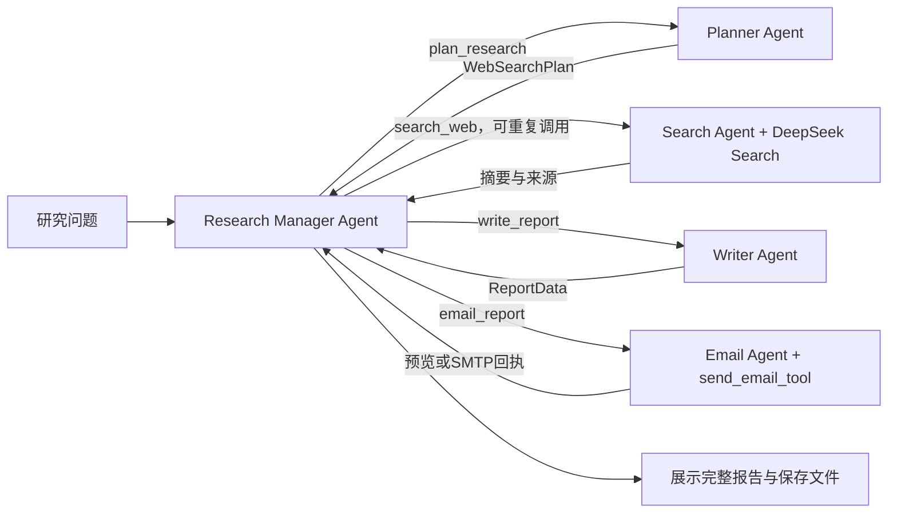

# Deep Research — Orchestration via Tools

[English](README.md) | **简体中文**

本项目是 OpenAI Agents SDK Lab 4 作业的独立可运行改造版，基于
[ed-donner/agents 的 Deep Research](https://github.com/ed-donner/agents/tree/62569708496917d5e2d5ce1652902d7c80f6b896/2_openai/deep_research)，
将 Lab 2 的 **Part 3 → 3a: via Tools** 应用到研究流程。

## 作业要求核对

截图指定 `agents/2_openai/deep_research/`，并要求 **Orchestration via Tools**。
因此需要保留 Deep Research 的工作内容，把控制权交给真正的 Manager Agent。
原项目的 `ResearchManager` 只是普通 Python 类，按代码顺序运行四个 Agent。
本版本新增 `Agent(name="Research Manager", tools=[...])`，用四个 `.as_tool()`
包装 Planner、Search、Writer 和 Email；每个工具执行结束后，结果返回 Manager。

这与 [OpenAI 官方 Agents as tools 模式](https://developers.openai.com/api/docs/guides/agents/orchestration)
一致。没有使用 handoffs，也没有把旧的四步流水线整体包成一个工具。
截图没有规定提交文件格式、评分细则或额外实验；本项目不假设这些要求。

## 快速运行（Windows PowerShell）

建议 Python 3.12。在项目根目录执行：

```powershell
python -m venv .venv
.\.venv\Scripts\python.exe -m pip install -r requirements.txt
if (!(Test-Path .env)) { Copy-Item .env.example .env }
```

本版本已适配用户的 **DeepSeek 官方 API**。编辑项目根目录 `.env`，至少填写：

```dotenv
MODEL_PROVIDER=deepseek
DEEPSEEK_API_KEY=你的DeepSeek官方API密钥
DEFAULT_MODEL_NAME=deepseek-flash
HOW_MANY_SEARCHES=5
ENABLE_TRACING=false
```

默认模型按 2026-10-25 查阅的 DeepSeek 官方文档设置为 `deepseek-flash`。
SDK 通过 DeepSeek 的 Responses API 调用模型，保留结构化输出和工具调用；
Search Agent 用函数工具调用 DeepSeek Search API，使用同一把 `DEEPSEEK_API_KEY`。
本模式不需要 OpenAI Key，也不向 OpenAI 上传 trace。模型访问权限、搜索权限和余额仍需在线验证。
真实运行会产生模型和搜索请求，按服务商规则计费。

如需切回最初的 OpenAI 版本，设置 `MODEL_PROVIDER=openai`、
`DEFAULT_MODEL_NAME=gpt-5.4-mini` 和 `OPENAI_API_KEY`，搜索将切回托管 `WebSearchTool`。
API 地址由所选 provider 明确指定，避免将 DeepSeek Key 发给错误服务商。

启动界面：

```powershell
.\.venv\Scripts\python.exe -m deep_research.app
```

在浏览器打开终端显示的本地地址，通常是 `http://127.0.0.1:7860`。
输入研究问题，点击 **Start research**。默认不勾选发送邮件，四个 Agent 仍都会参与，
Email Agent 会生成 `.eml` 邮件预览。

也可以通过命令行运行：

```powershell
.\.venv\Scripts\python.exe -m deep_research "Compare retrieval-augmented generation and fine-tuning for a university FAQ assistant."
```

## 邮件配置

核对的最新完整项目使用 SMTP（`messenger.py`）；本版本延续该方式，支持 SSL/TLS 与 STARTTLS。
默认仅生成本地预览，**预览不代表邮件已经发送**。
真实发送时还需在 `.env` 配置：

```dotenv
EMAIL_SMTP_SERVER=smtp.qq.com
EMAIL_SMTP_PORT=465
EMAIL_ADDRESS=你的QQ邮箱@qq.com
EMAIL_APP_PASSWORD=QQ邮箱生成的授权码
```

在网页独立的 **Email settings** 区域选择 **Send report by email** 并填写
**Recipient email**；开启发送时地址必填，关闭时只生成预览。
收件地址与发送开关按每次研究传入，不读取旧的 `.env` `EMAIL_TO`。
页面文字及报告、摘要、后续问题、邮件正文统一使用英文；研究问题仍可用中文输入。
命令行通过本次运行参数传入收件地址：

```powershell
.\.venv\Scripts\python.exe -m deep_research "Your research question" --send-email --recipient name@example.com
```

端口 465 使用隐式 SSL/TLS，其他端口要求 STARTTLS（通常为 587），均验证证书。
配置后可运行 `.venv/Scripts/python.exe -m deep_research.check_email` 验证登录，该命令不发送邮件。
修改 `.env` 后需重启 Gradio。尚未实现 OAuth 邮件登录。
**QQ 授权码步骤及 Gmail、MUST 学生邮箱说明见 [邮箱配置](docs/EMAIL_SETUP.md)。**
学校邮箱允许接收邮件不代表它允许密码式 SMTP 发送；学校租户是否开放此功能尚未验证。
状态 `accepted_by_smtp` 表示服务器已接受邮件，不证明已进入收件箱。
同一次研究内不会重复发送；发生超时时先检查邮箱，再决定是否重新运行。
不要提交 `.env`、应用密码或密钥；它们已被 `.gitignore` 排除。

## 核心实现

| 文件 | 职责 |
| --- | --- |
| `deep_research/manager_agent.py` | Manager 提示词、四个 `.as_tool()`、结构化结果提取 |
| `deep_research/research_manager.py` | 单次 `Runner.run_streamed(manager_agent, ...)`、事件展示、保存与完成检查 |
| `deep_research/planner_agent.py` | 输出 `WebSearchPlan`，默认规划 5 次搜索 |
| `deep_research/search_agent.py` | 按 provider 选择搜索工具，输出证据摘要与来源链接 |
| `deep_research/deepseek_search.py` | 调用 DeepSeek Search API，保留 URL、日期与证据文本 |
| `deep_research/providers.py` | 为 SDK 配置 DeepSeek 或 OpenAI 官方 Responses API |
| `deep_research/writer_agent.py` | 输出 `ReportData`，保留摘要、完整 Markdown、后续研究问题 |
| `deep_research/email_agent.py` | Email Agent 调用真实函数工具，生成预览或 SMTP 发送 |
| `deep_research/app.py` | Gradio 界面，显示 Manager 的工具调用记录 |
| `tests/` | 无外部网络的 SDK 编排、错误处理、邮件与配置测试 |



Manager 的提示词描述工作依赖，模型负责产生实际工具调用。
为了让依赖清晰，提示词要求 Manager 每次调用一个工具，收到结果后决定下一步；
可追加最多两次搜索。DeepSeek 文档说明 `parallel_tool_calls` 参数被忽略，
因此 SDK 额外设置工具执行并发上限为 1。此限制控制执行并发，并不保证模型一定只输出一个调用。
顶层 `max_turns` 和每个专业 Agent 的 `max_turns` 限制失控循环，但不保证固定费用。
额外搜索次数主要由提示词约束；真正的硬停止边界是运行轮数。
LLM 的实际选择和内容质量仍需要在线验证。

结果提取器只序列化或保存结果，不会自行调用下一阶段。
Planner / Writer 格式校验失败时，工具向 Manager 返回重试要求，由 Manager 再次调用
同一工具；每个阶段最多容许一次格式重试。其他错误与邮件发送不走此重试路径。
Writer 从当前运行状态读取原问题及全部搜索摘要，Manager 不再重复复制长证据到工具参数。
`ResearchManager` 类仍存在，但职责变为应用外壳；真正负责编排的是 `manager_agent.py` 中的 Agent。

## 运行产物与展示

每次研究保存到单独的 `outputs/<UTC时间_随机ID>/`：

- `report.md`：Writer 的原始完整报告，避免被 Manager 的短回复覆盖。
- `report.json`：完整 `ReportData`，含摘要和后续问题。
- `email.eml`：带纯文本及 HTML 正文的邮件预览。
- `email_status.json`：预览或 SMTP 接受状态。
- `workflow.json`：顶层工具调用顺序、运行状态和不含原始响应的格式诊断。
- `evidence.json`：原问题、规划及逐次保存的搜索摘要，失败时也可下载。

失败时保留已经生成的文件，未完成阶段不会显示成成功。
结构化校验仅允许去掉完整的外层 JSON 代码围栏，不补字段、不拼接截断报告。
完成检查验证计划、搜索结果数量、报告和邮件回执存在；它不验证研究事实，
也不严格证明每个计划查询的语义覆盖，需要结合工具记录与报告检查。
输出文件可能含研究内容和配置的邮箱地址，分享前请自行检查。

DeepSeek 模式保持 `ENABLE_TRACING=false`，使用本地 `workflow.json` 查看调用顺序。
只有 OpenAI 模式支持本项目的 `ENABLE_TRACING=true`；启用时配置
`trace_include_sensitive_data=False`，运行时显示 OpenAI trace 链接。
`workflow.json` 是本地调用记录，不等同于云端 trace。

## 测试

```powershell
.\.venv\Scripts\python.exe -m pip install -r requirements-dev.txt
.\.venv\Scripts\python.exe -m pytest -q
.\.venv\Scripts\ruff.exe check deep_research tests
.\.venv\Scripts\ruff.exe format --check deep_research tests
.\.venv\Scripts\python.exe -m compileall -q deep_research tests
```

测试用模拟模型代替外部 API，但实际执行 Agents SDK 的 Manager、嵌套 `.as_tool()`、
结构化输出、流式事件和邮件函数工具。测试中的报告只是固定样本，不是真实研究结果。
当前验证结果与未验证项目见 [作业说明](docs/ASSIGNMENT_NOTES.md)。

## 来源

- [基础项目](https://github.com/ed-donner/agents/tree/62569708496917d5e2d5ce1652902d7c80f6b896/2_openai/deep_research)
- [Lab 4：Deep Research 教学代码](https://github.com/ed-donner/agents/blob/62569708496917d5e2d5ce1652902d7c80f6b896/2_openai/4_lab4.ipynb)
- [Lab 2：Part 3 → 3a: via Tools](https://github.com/ed-donner/agents/blob/62569708496917d5e2d5ce1652902d7c80f6b896/2_openai/2_lab2.ipynb)
- [OpenAI 官方编排文档](https://developers.openai.com/api/docs/guides/agents/orchestration)
- [DeepSeek Responses API 与兼容性](https://api-docs.deepseek.com/guides/responses_api/)
- [DeepSeek Search API](https://api-docs.deepseek.com/guides/search/)

源码核对基准：`62569708496917d5e2d5ce1652902d7c80f6b896`（2026-10-25 核对）。
专业 Agent 的职责与数据模型改编自上游；独立包结构、Manager 编排、配置、
预览模式和测试为本次改造。上游 MIT 许可及 Ed Donner 版权声明保留在 `LICENSE`。
