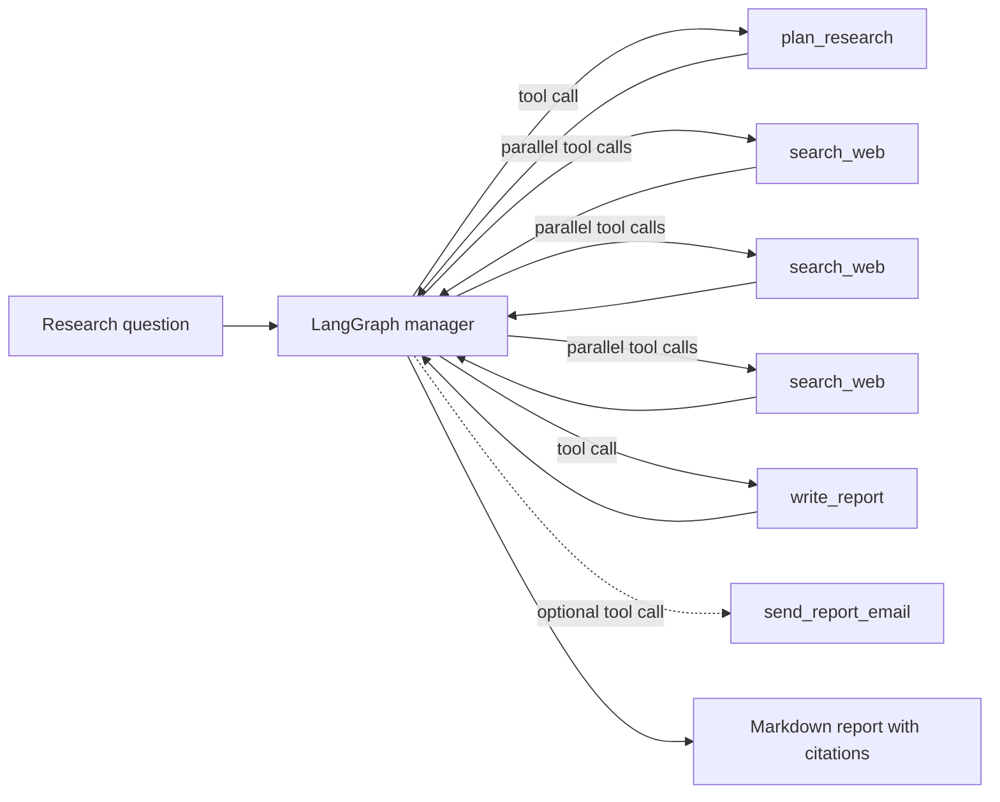

# Deep Research with LangGraph

**English** | [简体中文](docs/GUIDE.zh-CN.md)

This research agent uses LangChain and LangGraph to coordinate a tool-based workflow. DeepSeek handles planning, tool calls, and report writing. Tavily retrieves web sources, and the finished report can be sent through a NetEase SMTP account.

## Team contributions

All three members contributed equally. File paths are relative to `subgroup2/`.

| Member | Share | Files | Contribution |
| --- | ---: | --- | --- |
| **Wang Jianyu (王健瑀)** | **1/3 (33⅓%)** | [`deep_research/graph.py`](deep_research/graph.py) | Built the LangGraph state graph, manager node, and tool-call routing. |
| | | [`deep_research/toolkit.py`](deep_research/toolkit.py) | Implemented the research planning, web search, report writing, and email tools. |
| | | [`deep_research/service.py`](deep_research/service.py), [`deep_research/__init__.py`](deep_research/__init__.py) | Integrated the model, tools, and workflow, and streamed progress and reports to the UI. |
| | | [`deep_research/schemas.py`](deep_research/schemas.py) | Defined schemas for search plans, sources, and reports, including normalization for model output. |
| **Tu Jiaen (涂佳恩)** | **1/3 (33⅓%)** | [`deep_research/clients.py`](deep_research/clients.py) | Integrated Tavily search and NetEase SMTP, including search result normalization and email delivery. |
| | | [`deep_research/config.py`](deep_research/config.py), [`.env.example`](.env.example), [`pyproject.toml`](pyproject.toml) | Managed environment variables, configuration validation, and project dependencies. |
| | | [`tests/test_clients.py`](tests/test_clients.py), [`tests/test_config.py`](tests/test_config.py) | Tested search result handling, the email client, and configuration behavior. |
| **Li Tangzishun (李唐子顺)** | **1/3 (33⅓%)** | [`app.py`](app.py), [`styles.py`](styles.py) | Built the Gradio interface for entering questions, displaying progress, and rendering reports. |
| | | [`tests/test_workflow.py`](tests/test_workflow.py), [`tests/test_schemas.py`](tests/test_schemas.py) | Tested the complete workflow and compatibility with model output. |
| | | [`README.md`](README.md), [`.gitignore`](.gitignore) | Maintained setup and test instructions and Git ignore rules. |
| **Total** | **100%** | | |

## Architecture



- The manager decides which tools to call. The tools carry out planning, research, and writing.
- The planner returns structured Pydantic output with five complementary searches by default.
- The manager can issue several `search_web` calls in one turn. LangGraph's `ToolNode` runs them concurrently.
- The tools retain the search evidence for the current run, keeping long results out of the manager's message history.
- The writer uses the collected evidence and aims for a 1,200–2,000-word Markdown report with source links.
- NetEase SMTP delivery is optional. The SMTP credential stays in the email client.
- Gradio streams tool progress and displays the finished report.

## Quick start

Use Python 3.11 or later. Run these PowerShell commands from `subgroup2/`.

```powershell
py -3.11 -m venv .venv
.venv\Scripts\Activate.ps1
python -m pip install -e ".[dev]"
if (!(Test-Path .env)) { Copy-Item .env.example .env }
```

Set the DeepSeek and Tavily credentials in `.env`.

```dotenv
DEEPSEEK_API_KEY=...
DEEPSEEK_MODEL=deepseek-flash
DEEPSEEK_BASE_URL=https://api.deepseek.com
TAVILY_API_KEY=...
```

`langchain-openai` provides the OpenAI-compatible client. The client uses the DeepSeek key and model and sends requests to `DEEPSEEK_BASE_URL`.

Start Gradio and open the local URL printed in the terminal, typically `http://127.0.0.1:7860`.

```powershell
python app.py
```

### Optional NetEase email delivery

1. Sign in to NetEase Webmail.
2. In **Settings → POP3/SMTP/IMAP**, enable **IMAP/SMTP** or **POP3/SMTP**.
3. Generate a client authorization code and add the email settings to `.env`. `NETEASE_AUTH_CODE` takes this code.

```dotenv
NETEASE_EMAIL=your-name@163.com
NETEASE_AUTH_CODE=your-client-authorization-code
EMAIL_TO=recipient@example.com
```

The corresponding SMTP host is selected automatically for `@163.com`, `@126.com`, and `@yeah.net`. For a NetEase enterprise account, set the host and SSL port provided by your administrator.

```dotenv
NETEASE_SMTP_HOST=smtp.qiye.163.com
NETEASE_SMTP_PORT=465
```

`EMAIL_TO` defaults to `NETEASE_EMAIL`. Select the email option in Gradio to send the finished report.

## Configuration

| Variable | Default | Purpose |
| --- | --- | --- |
| `DEEPSEEK_API_KEY` | Required | DeepSeek API key |
| `DEEPSEEK_MODEL` | `deepseek-flash` | Model used for management, planning, and writing |
| `DEEPSEEK_BASE_URL` | `https://api.deepseek.com` | OpenAI-compatible DeepSeek API endpoint |
| `TAVILY_API_KEY` | Required | Tavily web search API key |
| `RESEARCH_SEARCH_COUNT` | `5` | Number of search tasks per run, from 1 to 10 |
| `RESEARCH_MAX_RESULTS` | `5` | Maximum results per search, from 1 to 10 |
| `NETEASE_EMAIL` | Unset | Full NetEase email address |
| `NETEASE_AUTH_CODE` | Unset | NetEase client authorization code |
| `EMAIL_TO` | `NETEASE_EMAIL` | Report recipient |
| `NETEASE_SMTP_HOST` | Inferred from sender domain | SMTP server |
| `NETEASE_SMTP_PORT` | `465` | SMTP over SSL port |

Alternative models need native tool calling and structured output support.

## Tests

```powershell
python -m pytest
ruff check .
```

The tests run offline with substitutes for model, search, and email calls.

## Mapping to the reference implementation

| Reference implementation | LangGraph implementation |
| --- | --- |
| `ResearchManager` calls agents in sequence | The LangGraph manager routes tool calls in a loop |
| `planner_agent` | The `plan_research` tool returns structured output |
| `search_agent` and OpenAI `WebSearchTool` | The `search_web` tool uses Tavily |
| `writer_agent` | The `write_report` tool returns `ReportData` |
| `email_agent` and SendGrid | The optional `send_report_email` tool uses NetEase SMTP |
| Gradio status updates | LangGraph events drive Gradio status updates |
