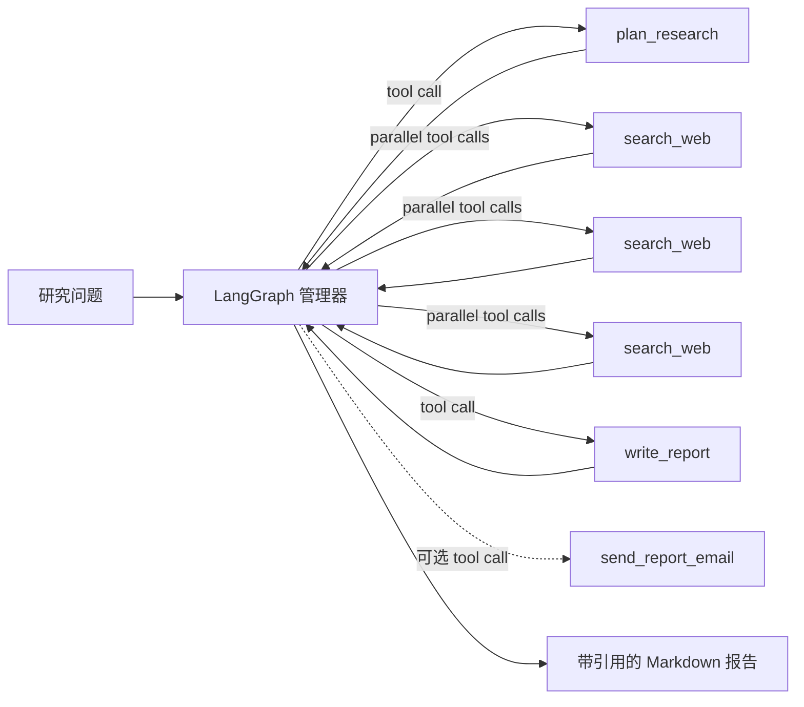

# LangGraph Deep Research（DeepSeek + 网易邮箱）

[English](../README.md) | **简体中文**

这是一个用 LangChain / LangGraph 编排的深度研究 Agent。DeepSeek 负责规划、工具调用和报告写作，Tavily 负责网页检索，最终报告可选择通过你自己的网易邮箱 SMTP 发送。

> 当前邮件能力只是“发送最终报告”，不会读取收件箱，也不会把邮箱授权码交给模型。

## 团队分工

王健瑀 40%，涂佳恩 31%，李唐子顺 29%。文件级职责见[英文 README 的团队分工](../README.md#team-contributions)。

## 架构



关键点：

- 管理器只负责决策和工具编排，不直接研究或撰写答案。
- 规划器使用 Pydantic 结构化输出，默认生成 5 个互补搜索任务。
- 管理器可在同一轮发出多个 `search_web` 调用；LangGraph 的 `ToolNode` 会并发执行它们。
- 搜索正文保存在单次运行的工具内存中，不要求管理器在消息中重复大段网页内容。
- 写作器只使用已收集证据，生成 1,200–2,000 字、包含 Markdown 链接的报告。
- 网易 SMTP 邮件是可选步骤，未勾选时不会要求邮件配置。
- Gradio 页面会流式显示每个工具阶段，最终展示完整报告。

## 快速开始

需要 Python 3.11 或更高版本。请在 subgroup2 项目目录中运行以下命令。

```powershell
py -3.11 -m venv .venv
.venv\Scripts\Activate.ps1
python -m pip install -e ".[dev]"
Copy-Item .env.example .env
```

编辑 `.env`，先设置 DeepSeek 和 Tavily：

```dotenv
DEEPSEEK_API_KEY=...
DEEPSEEK_MODEL=deepseek-flash
DEEPSEEK_BASE_URL=https://api.deepseek.com
TAVILY_API_KEY=...
```

`langchain-openai` 在这里只作为 OpenAI 兼容协议的客户端。实际请求会发往 `DEEPSEEK_BASE_URL`，使用的也是 DeepSeek 密钥和模型。

### 配置网易邮箱发信

1. 登录网易邮箱网页版。
2. 进入“设置 → POP3/SMTP/IMAP”，开启 `IMAP/SMTP` 或 `POP3/SMTP` 服务。
3. 新增并保存“客户端授权码”。不要使用网易邮箱的网页登录密码。
4. 在 `.env` 里增加：

```dotenv
NETEASE_EMAIL=your-name@163.com
NETEASE_AUTH_CODE=your-client-authorization-code
EMAIL_TO=recipient@example.com
```

`@163.com`、`@126.com` 和 `@yeah.net` 会自动选择相应的 SMTP 主机。如果是网易企业邮箱，请再明确配置管理员提供的主机和 SSL 端口，例如：

```dotenv
NETEASE_SMTP_HOST=smtp.qiye.163.com
NETEASE_SMTP_PORT=465
```

如果不写 `EMAIL_TO`，程序会默认把报告发给 `NETEASE_EMAIL` 自己。

启动：

```powershell
python app.py
```

打开终端中显示的本地地址（通常是 `http://127.0.0.1:7860`）。

## 可选配置

| 变量 | 默认值 | 用途 |
|---|---:|---|
| `DEEPSEEK_API_KEY` | 无 | DeepSeek API 密钥 |
| `DEEPSEEK_MODEL` | `deepseek-flash` | 管理器、规划器与写作器所用模型 |
| `DEEPSEEK_BASE_URL` | `https://api.deepseek.com` | DeepSeek 的 OpenAI 兼容 API 地址 |
| `TAVILY_API_KEY` | 无 | Tavily 网页检索密钥 |
| `RESEARCH_SEARCH_COUNT` | `5` | 每次研究的搜索任务数，范围 1–10 |
| `RESEARCH_MAX_RESULTS` | `5` | 每次搜索保留的结果数，范围 1–10 |
| `NETEASE_EMAIL` | 无 | 完整的网易邮箱地址 |
| `NETEASE_AUTH_CODE` | 无 | 网易客户端授权码，不是登录密码 |
| `EMAIL_TO` | `NETEASE_EMAIL` | 固定的报告收件地址 |
| `NETEASE_SMTP_HOST` | 按邮箱后缀推断 | SMTP 服务器 |
| `NETEASE_SMTP_PORT` | `465` | SMTP over SSL 端口 |

如果使用的兼容模型不支持原生工具调用和结构化输出，需要改用支持这些能力的模型。

## 测试

```powershell
pytest
ruff check .
```

测试不会调用真实模型、搜索或邮件 API。

## 与参考实现的对应关系

| 参考项目 | 本项目 |
|---|---|
| `ResearchManager` 顺序调用各 Agent | LangGraph 管理器以工具调用循环动态编排 |
| `planner_agent` | `plan_research` 工具 + 结构化输出 |
| `search_agent` + OpenAI WebSearchTool | `search_web` 工具 + Tavily |
| `writer_agent` | `write_report` 工具 + `ReportData` |
| `email_agent` + SendGrid tool | 可选 `send_report_email` 工具 + 网易 SMTP |
| Gradio 状态更新 | LangGraph 事件流驱动的 Gradio 状态更新 |
